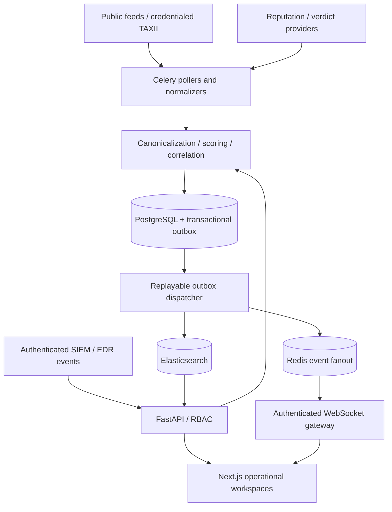

# ThreatLens architecture

## Classified references/history and asynchronous exports
Additive migrations 0002–0005 introduce classified narrative, optimistic versions, reference-sync metadata, normalized ATT&CK mappings, immutable hourly risk snapshots, per-attempt export/PDF manifests and report-operation leases. They guard creation because baseline 0001 uses ORM metadata. Migration, trigger, grant and append-only behaviour is exercised against PostgreSQL 17 by the isolated integration suite (`TEST_DATABASE_URL`), most recently 187 passing tests on 2026-11-15.

Official MITRE enterprise STIX is validated before atomic catalog updates. Unresolved analyst IDs contain no invented reference metadata. The coverage overlay measures active IOC mappings, not detection effectiveness. Historical risk is captured from the actual store at the time of capture, never backfilled from today's data.

Leased export workers consume transactional outbox jobs, stream bounded database pages to private per-attempt CSV/STIX files and publish only complete manifest-validated artifacts. Current-state handling and integrity checks protect downloads. Source row locks and optimistic revisions address concurrent changes; actual PostgreSQL contention/stream lifetime remains a separate gate. See the classification and handling policy in [SECURITY.md](SECURITY.md#classification-and-handling-policy) and the background export contracts in [API.md](API.md#background-csvstix-exports).

Baseline: supplied PRD v1.0, all 26 pages read on 2026-10-17. All FRs including Should/Could are in scope. This is a single-organization installation: no registration or tenant selector. PostgreSQL is authoritative. Next.js/TypeScript, TanStack Query, Recharts and Leaflet consume FastAPI REST/WebSocket APIs. SQLAlchemy/Alembic manage persistence. Celery/Redis run independent feed polling, enrichment, expiry, reports and transactional-outbox dispatch. Elasticsearch stores rebuildable projections. Docker Compose is the local deployment; Kubernetes targets managed backing services.

## Integrity and identity
Canonical indicators have a unique (type,value), provenance a unique (indicator,feed), security events a unique (source,external_id). Outbox records commit with business changes; indexing uses deterministic IDs and realtime consumers refetch authoritative state. At-least-once delivery is intentional. Audit/timeline rows are insert-only with PostgreSQL triggers; audit payload digests support integrity checking. Database-owner attacks require external immutable backups/checkpoints.

Access JWTs expire after 10 minutes; refresh credentials are opaque, hashed in PostgreSQL and single-use with family revocation on reuse. Passwords use Argon2. Role/account changes revoke existing sessions. Refresh cookies are HttpOnly, same-site and secure in production. First administrator is created through a local CLI with a prompted password.

## Section 11 contextual permission decisions
The PRD does not define the exact boundaries of ◐. These conservative installation policies apply:
- Security Engineer: acknowledge/assign only alerts assigned to self; audit limited to own actions and feed/integration activity; no incident writes.
- Threat Hunter: annotate/tag only (no enrichment or canonical edits); manage own assigned alerts through acknowledgement/in-progress; create and append own investigations, but cannot resolve others' incidents.
- SOC Analyst: manage alerts; create/escalate incidents and append own incident notes, but incident resolution/ownership changes require IR/Admin; save own hunts and export TLP:clear only.
- IR canonical edits require an existing incident link; full incident management.
- Executive: aggregate dashboards and own summary reports only; no IOC/event search, raw exports or operational detail endpoints.
- Reports and layouts are owner-scoped; Administrator can review all. TLP:red is never exported; amber/green exports require an explicit internal audience and an authorized role.

## Scoring v1
Weighted sum: reputation 35%, confidence 30%, recency 20%, internal sightings 15%. Inputs clamped 0–100, missing reputation/confidence zero; recency linearly decays over 30 days, future times treated as now; sightings saturate at 10. Round half-up to nearest integer. No missing provider result is represented as benign. Overall risk is the mean active IOC score, explicitly an intelligence-priority measure rather than measured enterprise compromise probability.

## Deployment decisions
### 2026-10-28 continuation details
The backend container image (`backend/Dockerfile`) pins `python:3.11-slim`; the local verification environment used Python 3.12.14. Both resolve the same `backend/requirements.txt`. Docker Compose is the supported local deployment, and the full service-backed suite (PostgreSQL 17, Redis 7, Elasticsearch 8) passes in that environment. Kubernetes cloud deployment is a documented operator step, not a local claim.

Outbox dispatch performs bounded bulk indexing before publication and then marks delivery in the transaction. It remains at-least-once: consumers must refetch authorized current state, and concurrent stale projection/restart tests are pending. `SEARCH_INDEX` scopes both search and the Redis pub/sub channel (`<index>:events`); the isolated test harness uses `threatlens_test`. Redis logical DB numbers alone do not isolate pub/sub.

Enrichment v2 cache identities include provider, endpoint, parameters and a credential fingerprint; observation timestamps/expiry are not refreshed on cache hits. Provider quotas/Retry-After produce persisted deferred results and queued retries. New eligible IOC insertions queue enrichment in the same transaction. Existing/changed-IOC automatic refresh remains future work. `GEOLOCATION_ENABLED` defaults false until entitlement is confirmed.

Python 3.11 and Node 24 are installed. PostgreSQL 17, Redis 7 and Elasticsearch 8 are selected. PyJWT and argon2-cffi replace the illustrative python-jose/passlib libraries. PDF uses ReportLab without external URL rendering. Development HTTP is loopback-only; production TLS, encrypted disks, secrets mounts and service authentication require operator configuration and separate verification.
